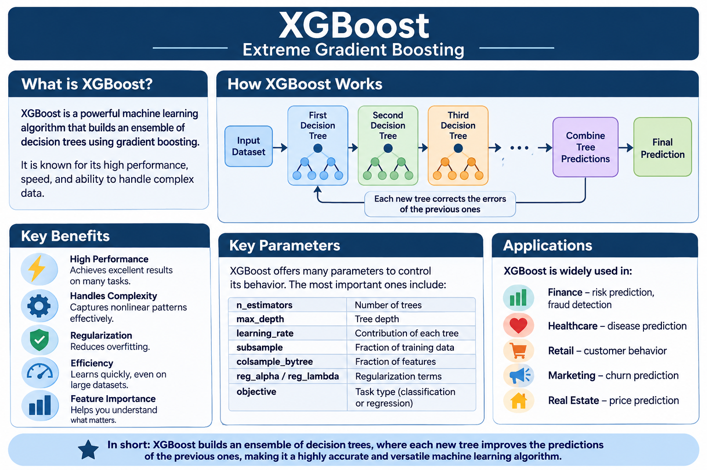

# XGBoost – Extreme Gradient Boosting

## 1. Introduction

**XGBoost (Extreme Gradient Boosting)** is a powerful machine learning algorithm based on gradient-boosted decision trees.

It belongs to the family of ensemble learning methods, which combine multiple machine learning models to produce more accurate predictions.

XGBoost is particularly popular because it offers:
- High predictive performance.
- Fast and efficient training.
- Regularization to reduce overfitting.
- Support for missing values.
- Feature importance analysis.
- Scalability for large datasets.

It can be used for both classification and regression problems.

## 2. How Does XGBoost Work?

XGBoost uses an ensemble of decision trees that are built sequentially.

Unlike traditional methods that build independent trees, gradient boosting trains each new tree to improve the predictions made by the previous trees.

The general process is:

1. **Initial prediction:** The algorithm makes an initial prediction based on the training data.
2. **Calculate errors:** It measures how far the predictions are from the actual values.
3. **Build a new tree:** A new decision tree learns patterns that help correct previous prediction errors.
4. **Improve predictions:** The new tree contributes to the existing model.
5. **Repeat:** The process continues until the desired number of trees is reached or training stops.

The final prediction is obtained by combining the contributions of all the trees.

## 3. Gradient Boosting

Gradient boosting is the core concept behind XGBoost.

It uses gradient information from a loss function to determine how the model should improve.

A loss function measures the difference between predicted values and actual values.

During training, XGBoost attempts to minimize this loss by adding new decision trees.

The optimization process also considers regularization, which helps prevent the model from becoming unnecessarily complex.

## 4. Decision Trees and Ensemble Learning

A decision tree makes predictions by splitting data into smaller groups based on feature values.

For example, when predicting house prices, a tree might consider:
- Property size.
- Number of bedrooms.
- Location.
- Property age.

A single decision tree may have limited predictive power.

XGBoost combines many trees into an ensemble. Each tree contributes to the final prediction, allowing the model to capture more complex relationships in the data.

## 5. Important XGBoost Parameters

XGBoost provides several parameters that control model complexity, learning speed, and regularization.

| Parameter | Description |
|---|---|
| `n_estimators` | Number of boosting trees |
| `max_depth` | Maximum depth of each decision tree |
| `learning_rate` | Controls the contribution of each new tree |
| `subsample` | Fraction of training observations used per tree |
| `colsample_bytree` | Fraction of features selected per tree |
| `reg_alpha` | L1 regularization |
| `reg_lambda` | L2 regularization |
| `objective` | Defines the prediction task and loss function |

Choosing appropriate parameter values is important for balancing predictive performance and overfitting.

## 6. Classification and Regression

XGBoost supports two major types of machine learning tasks.

### Classification

Classification predicts a category or class.

Examples:
- Predicting whether a customer will leave a company.
- Detecting fraudulent transactions.
- Classifying emails as spam or legitimate.
- Predicting whether a patient has a particular disease.

### Regression

Regression predicts a continuous numerical value.

Examples:
- Predicting house prices.
- Forecasting sales.
- Estimating customer lifetime value.
- Predicting product demand.

## 7. Advantages of XGBoost

**High Performance**

XGBoost often achieves excellent predictive results on structured and tabular datasets.

**Regularization**

L1 and L2 regularization help control model complexity and reduce overfitting.

**Handling Missing Values**

The algorithm can learn how to handle missing feature values during training.

**Efficiency**

Optimized computation and parallel processing make training efficient.

**Feature Importance**

XGBoost provides methods for understanding which features contribute most to predictions.

**Flexibility**

It supports classification, regression, and ranking tasks.

## 8. Applications

XGBoost is widely used across different industries.

| Industry | Application |
|---|---|
| Finance | Credit risk and fraud detection |
| Healthcare | Disease prediction |
| Retail | Customer behavior prediction |
| Marketing | Customer churn prediction |
| Real Estate | Property price prediction |
| Manufacturing | Predictive maintenance |
| E-commerce | Product recommendation and demand forecasting |

## 9. XGBoost vs. Random Forest

Both algorithms use decision trees, but they build their models differently.

| Feature | Random Forest | XGBoost |
|---|---|---|
| Learning approach | Bagging | Boosting |
| Tree construction | Mostly independently | Sequentially |
| Main objective | Reduce variance | Correct prediction errors |
| Overfitting control | Averaging and tree constraints | Regularization and tree constraints |
| Training | Trees can be trained in parallel | Boosting iterations are sequential |
| Performance | Strong baseline | Often excellent on tabular data |

Neither algorithm is always better. Performance depends on the dataset, parameter tuning, and evaluation methodology.

## 10. Conclusion

XGBoost is a powerful and flexible machine learning algorithm that combines multiple decision trees using gradient boosting.

Its ability to learn complex patterns, minimize prediction errors, and control model complexity makes it an excellent choice for many real-world classification and regression problems.

**Key takeaway:** XGBoost builds decision trees sequentially, with each new tree improving the predictions of the existing ensemble.