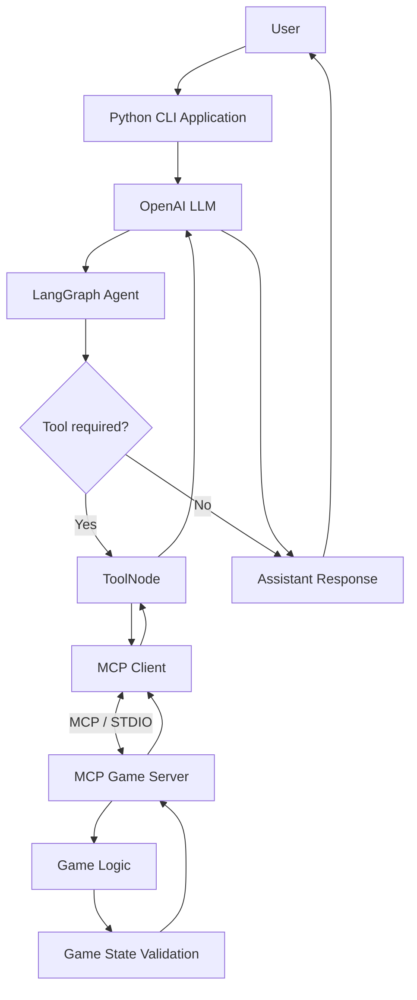

# 🤖 Agentic AI Tic-Tac-Toe Assistant

An AI-powered Tic-Tac-Toe game assistant built with **Python, OpenAI, LangChain, LangGraph and Model Context Protocol (MCP)**.

The project demonstrates how Large Language Models (LLMs) can interact with external tools through an agentic workflow. The AI understands user instructions, decides when to invoke tools, executes game operations through an MCP server and responds based on the actual game state.

## 🚀 Project Overview

This application allows a user to play Tic-Tac-Toe against an AI assistant through a conversational command-line interface.

Instead of implementing game operations directly inside the LLM, the application uses the Model Context Protocol (MCP) to expose game functionality as tools.

The LLM acts as the reasoning engine, while the MCP server handles the game logic and validates operations.

**Key capabilities:**
- Start or reset a Tic-Tac-Toe game.
- Make moves through natural language instructions.
- Allow the AI to play as O against the user.
- Retrieve the current game board and game status.
- Validate moves and prevent invalid operations.
- Detect winning conditions and draws.
- Maintain conversational context during the session.
- Execute external tools through MCP.

## 🏗️ Architecture

The application follows an agentic architecture using LangGraph to orchestrate interactions between the LLM and external tools.

### Workflow

1. The user submits a natural language request.
2. The OpenAI model interprets the request.
3. The model determines whether an MCP tool is required.
4. LangGraph routes the request to the appropriate tool.
5. The MCP server executes the requested game operation.
6. The tool returns the updated game state.
7. The LLM processes the result and generates a response.

### Architecture Diagram



## 🛠️ Technology Stack

| Technology | Purpose |
|---|---|
| Python | Core application development |
| OpenAI | LLM and natural language understanding |
| LangChain | LLM integration and tool binding |
| LangGraph | Agent workflow orchestration |
| Model Context Protocol (MCP) | Communication between the AI application and game server |
| FastMCP | Exposing game operations as MCP tools |
| python-dotenv | Environment variable management |
| AsyncIO | Asynchronous application execution |

## 📂 Project Structure

```text
tic-tac-toe-agent/
│
├── app.py              # Main AI agent application
├── app_server.py       # MCP server and game logic
├── .env                # API key configuration
├── requirements.txt    # Python dependencies
└── README.md           # Project documentation
```

## ⚙️ Installation and Setup

### 1. Clone the repository

```bash
git clone <your-repository-url>
cd tic-tac-toe-agent
```

### 2. Create a virtual environment

```bash
python -m venv .venv
```

Activate it:

**Windows:**
```bash
.venv\Scripts\activate
```

**macOS / Linux:**
```bash
source .venv/bin/activate
```

### 3. Install dependencies

```bash
pip install -r requirements.txt
```

### 4. Configure your OpenAI API key

Create a `.env` file in the project root:

```env
OPENAI_API_KEY=your_openai_api_key
```

The OpenAI model is configured directly in `app.py`.

### 5. Run the application

```bash
python app.py
```

The application automatically starts the MCP server as a subprocess and establishes communication using the STDIO transport.

## 🎮 How to Play

Once the application starts, you can interact with the assistant using natural language.

Example conversation:

```text
Tic-Tac-Toe AI Assistant

You: Start a new game

Assistant:
New game started!
You play as X, and I play as O.

Board:
 0 | 1 | 2
-----------
 3 | 4 | 5
-----------
 6 | 7 | 8

Your turn!

You: Place X at position 4

Assistant:
Your move was successful!

Board:
 0 | 1 | 2
-----------
 3 | X | 5
-----------
 6 | 7 | 8

It's my turn now. I'll make a move.

You: Show me the current board

Assistant:
Here is the current game board...
```

Other supported natural language requests include:

- "Start a new game."
- "Make your move."
- "Show me the current board."
- "What's the current game status?"
- "Reset the game."

Type `quit` or `exit` to close the application.

## 🔌 MCP Tools

The MCP server exposes three tools to the AI agent:

| Tool | Description |
|---|---|
| `start_game()` | Starts or resets a game and initializes the board. |
| `get_game_state()` | Returns the current board, player and game status. |
| `make_move(position)` | Executes a move for the current player after validating the position. |

The tools allow the LLM to interact with the game without directly accessing or modifying its internal state.

## 🧠 Agentic AI Concepts Demonstrated

This project demonstrates several important concepts in modern Generative AI development.

**1. LLM Tool Calling**

The model can determine when an external operation is needed and invoke the appropriate tool.

**2. Agent Orchestration with LangGraph**

A state graph manages the interaction between the LLM and MCP tools, including conditional routing and iterative tool execution.

**3. Model Context Protocol (MCP)**

MCP provides a standardized communication interface between the AI application and the external game server.

**4. Conversational State Management**

LangGraph's `MessagesState` maintains conversation messages, allowing the assistant to use previous interactions as context.

**5. Tool-based Execution and Validation**

Game operations are performed by the MCP server rather than being simulated by the LLM. This helps prevent fabricated game states and invalid moves.

## 🔮 Potential Future Enhancements

- Implement persistent game sessions.
- Add server-side player permissions and move validation.
- Introduce automated tests using pytest.
- Add a graphical user interface using Streamlit.
- Implement a Minimax-based AI opponent for optimal game strategy.
- Add multiple game sessions and player support.
- Introduce a RAG component to retrieve game strategies and historical game information.

## 🎯 Project Scope

This project focuses on **Generative AI and Agentic AI**, particularly LLM tool calling, agent orchestration and MCP integration.

It does not currently implement Retrieval-Augmented Generation (RAG), embeddings or vector database retrieval.

## 👨‍💻 Learning Objectives

The project was developed to explore practical applications of agentic AI and understand how LLMs can interact with external systems.

Key learning areas include:

- Building LLM-powered applications with Python.
- Integrating OpenAI models using LangChain.
- Designing agent workflows using LangGraph.
- Exposing external functionality through MCP.
- Implementing tool-based agent interactions.
- Managing conversational state and asynchronous execution.

---

**Built with Python, OpenAI, LangChain, LangGraph and MCP.**
